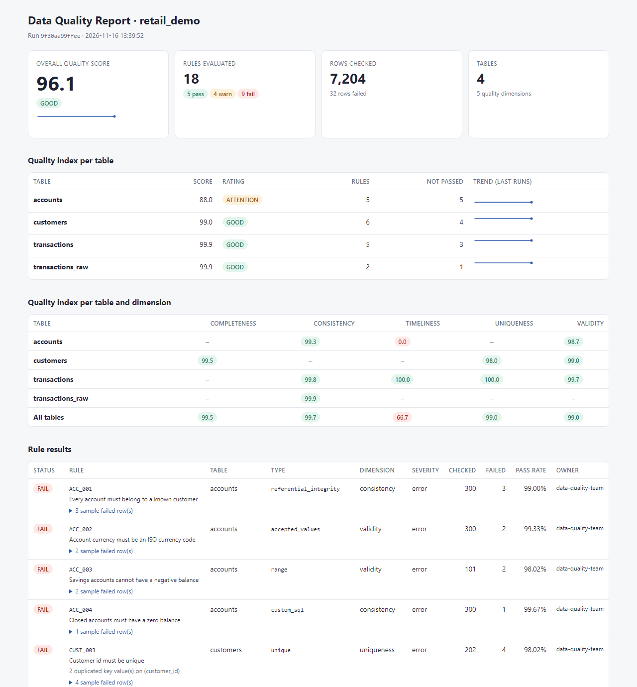
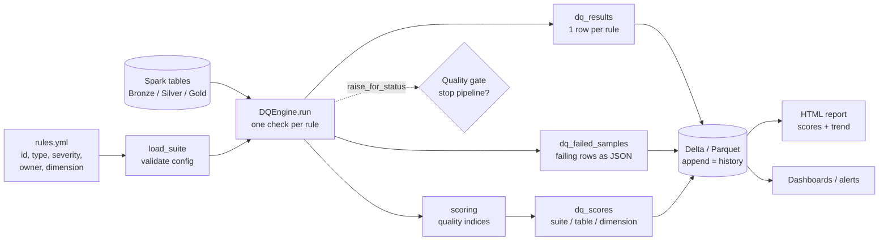
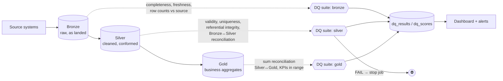

# data-quality-framework

[](https://github.com/milansta6/data-quality-framework/actions/workflows/ci.yml)


A small, reusable, **config-driven data quality framework** for PySpark and SQL.

You describe your checks in YAML. The engine runs them on Spark DataFrames, stores the
results as Delta or Parquet, calculates **one quality score per dataset**, and writes an
HTML report after every run. It runs on your laptop with plain PySpark and works the same
way on Databricks.

> All data in this repository is **synthetic** (fake customers, accounts and transactions
> generated from a fixed random seed).



---

## Contents

- [Why](#why)
- [How it works](#how-it-works)
- [Quick start](#quick-start)
- [Writing rules](#writing-rules)
- [Results](#results)
- [Quality indices](#quality-indices)
- [Bronze / Silver / Gold](#how-it-fits-into-a-bronze--silver--gold-pipeline)
- [Databricks](#databricks)
- [Adding a new rule type](#adding-a-new-rule-type)
- [Project layout](#project-layout)
- [Development](#development)

## Why

Data quality checks often start as SQL scripts copied from project to project. They are
hard to review, hard to reuse, and the results end up in logs nobody reads. This framework
keeps the good parts (SQL, Spark, simple tables) and adds structure:

- **Rules are configuration, not code.** Analysts and data owners can read and review them.
- **Every rule has an owner, a severity and a quality dimension.** So you know who to call
  and how bad a failure is.
- **Results are data.** One row per rule per run, appended to a table, so you can build
  dashboards, alerts and trends on top.
- **One number per dataset.** Business users get a score (0–100) and a rating, not a
  list of 200 checks.

## How it works



1. **Load** – the YAML suite is parsed and validated (unknown rule types, missing
   parameters, wrong severities, and duplicate ids fail fast, before Spark starts).
2. **Run** – each active rule becomes one Spark job. A rule that crashes (bad SQL, missing
   column) gets status `ERROR`; all other rules still run.
3. **Score** – pass rates are aggregated into quality indices.
4. **Store** – results, failed-row samples and scores are appended to Delta/Parquet.
5. **Report** – a self-contained HTML report is written (no JavaScript, easy to e-mail).

## Quick start

Requirements: Python 3.9+, Java 17 (for local PySpark).

```bash
git clone https://github.com/milansta6/data-quality-framework.git
cd data-quality-framework
python -m venv .venv && source .venv/bin/activate     # Windows: .venv\Scripts\activate
pip install -e ".[dev]"

# Check the YAML (no Spark needed)
dq validate examples/demo_suite.yml

# Run the demo suite on synthetic data, store results, write the HTML report
dq run examples/demo_suite.yml --demo-data
```

Output:

```text
Suite 'retail_demo' run 6432ba6c77a6: score 96.1 (18 rules: FAIL=9, WARN=4, PASS=5)
  PASS  CUST_001     customers          pass_rate= 100.00%
  FAIL  CUST_003     customers          pass_rate=  98.02%  2 duplicated key value(s) on (customer_id)
  WARN  ACC_005      accounts           pass_rate=   0.00%  latest=2026-11-15 07:23:08, age=30.0h, limit=24h
  WARN  REC_001      transactions_raw   pass_rate=  99.70%  source=1000, target=997, diff=3
  ...
Saved dq_results         -> dq_output/dq_results
Saved dq_failed_samples  -> dq_output/dq_failed_samples
Saved dq_scores          -> dq_output/dq_scores
HTML report             -> dq_output/reports/dq_report_6432ba6c77a6.html
```

The command exits with code `1` when a rule with severity `error` fails (`--fail-on`
changes this), so it can be used directly as a step in a scheduler or CI job.

From Python:

```python
from dq import DQEngine, ResultStore, render_html_report

engine = DQEngine(spark, "rules/customers.yml")
result = engine.run(
    {"customers": spark.table("silver.customers"), "accounts": spark.table("silver.accounts")}
)

result.results.show()  # Spark DataFrame, one row per rule
ResultStore(spark, path="/data/dq").save(result)
render_html_report(result, "dq_report.html")
result.raise_for_status()  # stop the pipeline on blocking failures
```

See [`examples/run_demo.py`](examples/run_demo.py) for a full script.

## Writing rules

A suite is one YAML file. Every rule has the same **common fields**:

| Field         | Required | Meaning                                                                  |
|---------------|----------|--------------------------------------------------------------------------|
| `id`          | yes      | Unique id, e.g. `CUST_001`                                               |
| `table`       | yes      | Name of the table the rule checks                                        |
| `type`        | yes      | Rule type (see below)                                                    |
| `description` |          | What the rule means in business language                                 |
| `severity`    |          | `error` (blocks the pipeline) or `warning` (default `error`)             |
| `active`      |          | `true` / `false` – switch a rule off without deleting it                 |
| `owner`       |          | Team or person responsible for fixing the data                           |
| `dimension`   |          | `completeness`, `validity`, `uniqueness`, `consistency`, `timeliness` (a sensible default per type) |
| `threshold`   |          | Minimum pass rate (0–1) for the rule to pass, default `1.0` (100 %)      |
| `filter`      |          | Optional SQL `WHERE` expression to check only part of the table          |

Every other key is a parameter of the rule type.

### Built-in rule types

| Type                       | Checks                                                     | Parameters                                                          | Default dimension |
|----------------------------|------------------------------------------------------------|---------------------------------------------------------------------|-------------------|
| `not_null`                 | Column(s) are filled                                       | `column` or `columns`, `treat_blank_as_null`                        | completeness      |
| `unique`                   | Key (one or more columns) has no duplicates                | `column` or `columns`                                               | uniqueness        |
| `accepted_values`          | Value is in an allowed list                                | `column`, `values`, `case_insensitive`                              | validity          |
| `range`                    | Value is between min and max (numbers, dates)              | `column`, `min` and/or `max`, `inclusive`                           | validity          |
| `regex`                    | Value matches a format                                     | `column`, `pattern`                                                 | validity          |
| `referential_integrity`    | Foreign key exists in another table                        | `column`, `reference_table`, `reference_column`                     | consistency       |
| `freshness`                | Newest record is recent enough (table level)               | `column`, `max_age_hours`                                           | timeliness        |
| `row_count_reconciliation` | Two tables have the same number of rows                    | `target_table`, `tolerance`, `tolerance_pct`, `target_filter`       | consistency       |
| `sum_reconciliation`       | Two tables have the same total of a column                 | `column`, `target_table`, `target_column`, `tolerance`, `tolerance_pct` | consistency   |
| `custom_sql`               | Any SQL that returns the **failing** rows                  | `sql`, `depends_on`                                                 | validity          |

Validity rules (`accepted_values`, `range`, `regex`) ignore `NULL` values, because a
missing value is a completeness problem, which `not_null` measures. Set `ignore_nulls: false` to
count `NULL` as a failure. Run `dq rules` to list all registered types.

### Example

```yaml
suite: retail_demo

defaults:                 # applied to every rule unless overridden
  owner: data-quality-team
  severity: error

output:
  path: dq_output         # local folder, DBFS, S3, ADLS... or `database: main.dq`
  format: parquet         # parquet | delta
  sample_size: 10         # failing rows kept per rule

rules:
  - id: CUST_002
    table: customers
    type: not_null
    column: email
    threshold: 0.98       # up to 2 % missing e-mails is acceptable
    severity: warning
    owner: crm-team
    description: Customers should have an e-mail address

  - id: ACC_001
    table: accounts
    type: referential_integrity
    column: customer_id
    reference_table: customers
    description: Every account must belong to a known customer

  - id: ACC_003
    table: accounts
    type: range
    column: balance
    min: 0
    filter: "account_type = 'SAVINGS'"
    description: Savings accounts cannot have a negative balance

  - id: TRX_005
    table: transactions
    type: custom_sql
    depends_on: [accounts]
    dimension: consistency
    sql: |
      SELECT t.* FROM transactions t
      JOIN accounts a ON t.account_id = a.account_id
      WHERE CAST(t.transaction_ts AS DATE) < a.opened_date
    description: A transaction cannot be booked before the account was opened

  - id: REC_001
    table: transactions_raw
    type: row_count_reconciliation
    target_table: transactions
    severity: warning
    description: All raw transactions must arrive in the Silver layer
```

The full example with all 10 rule types is in [`examples/demo_suite.yml`](examples/demo_suite.yml).

To read tables directly from the CLI (instead of passing DataFrames), add a `tables` section:

```yaml
tables:
  customers: {path: /data/silver/customers, format: delta}
  accounts:  {table: main.silver.accounts}          # catalog table
  raw_file:  {path: /landing/file.csv, format: csv, options: {header: true}}
```

## Results

**`dq_results`** – one row per rule per run:

| rule_id  | table_name       | dimension    | rows_checked | rows_failed | pass_rate | status |
|----------|------------------|--------------|-------------:|------------:|----------:|--------|
| CUST_001 | customers        | completeness |          202 |           0 |  1.0      | PASS   |
| CUST_003 | customers        | uniqueness   |          202 |           4 |  0.980198 | FAIL   |
| CUST_004 | customers        | validity     |          202 |           4 |  0.980198 | WARN   |
| ACC_001  | accounts         | consistency  |          300 |           3 |  0.99     | FAIL   |
| ACC_005  | accounts         | timeliness   |            1 |           1 |  0.0      | WARN   |
| TRX_005  | transactions     | consistency  |          997 |           1 |  0.998997 | FAIL   |
| REC_001  | transactions_raw | consistency  |         1000 |           3 |  0.997    | WARN   |
| REC_002  | transactions_raw | consistency  |            1 |           0 |  1.0      | PASS   |

More columns: `run_id`, `run_ts`, `suite`, `rule_type`, `severity`, `owner`, `description`,
`threshold`, `details` (e.g. `source=1000, target=997, diff=3`), `error_message`, `duration_seconds`.

**Status** logic:

| Status  | When                                                              |
|---------|-------------------------------------------------------------------|
| `PASS`  | pass rate ≥ threshold (or within tolerance for reconciliations)   |
| `WARN`  | not passed, severity `warning`                                    |
| `FAIL`  | not passed, severity `error`                                      |
| `ERROR` | the rule could not run (bad SQL, missing column or table)         |

**`dq_failed_samples`** – up to `sample_size` failing rows per rule, stored as JSON so that
one table can hold samples from any source table:

```text
rule_id   table_name  row_data
CUST_003  customers   {"customer_id":"C00011","first_name":"...","email":"...@example.com",...}
CUST_002  customers   {"customer_id":"C00006","first_name":"...","email":null,...}
```

**`dq_scores`** – the quality indices (next section).

## Quality indices

Many rule results are hard to read. A quality index turns them into **one number per dataset**:

- Each rule scores `pass_rate × 100`. A rule with status `ERROR` scores 0.
- Rules are weighted by severity (`error` = 2, `warning` = 1, configurable).
- A score is the weighted average of its rules, calculated for four scopes:

| scope             | One score per…                     | Example use                       |
|-------------------|------------------------------------|-----------------------------------|
| `suite`           | run                                | "Overall data quality: 96.1"      |
| `table`           | dataset                            | KPI for the data owner            |
| `dimension`       | quality dimension, all tables      | "Timeliness is our weak spot"     |
| `table_dimension` | dataset × dimension                | heat map in the report            |

- A rating translates the number: **GOOD** ≥ 95, **ATTENTION** ≥ 80, **CRITICAL** < 80
  (configurable under `scoring.ratings`).

| scope | table_name       | score | rating    | rules_evaluated | rules_not_passed |
|-------|------------------|------:|-----------|----------------:|-----------------:|
| suite | ALL              | 96.14 | GOOD      |              18 |               13 |
| table | accounts         | 88.0  | ATTENTION |               5 |                5 |
| table | customers        | 98.96 | GOOD      |               6 |                4 |
| table | transactions     | 99.9  | GOOD      |               5 |                3 |
| table | transactions_raw | 99.9  | GOOD      |               2 |                1 |

Because every run is **appended**, the score history is a trend:

```sql
SELECT run_ts, table_name, score
FROM main.data_quality.dq_scores
WHERE scope = 'table'
ORDER BY run_ts
```

The HTML report shows this trend as a small line chart per table.

> **Note:** a table can score 99 and still have failed rules. The score measures *how much*
> of the data is good, while the status says whether a rule's agreed threshold was met. Use
> the score for monitoring and trends, and the status for alerts and quality gates.

## How it fits into a Bronze / Silver / Gold pipeline



| Layer      | Typical rules                                                                     | On failure                         |
|------------|-----------------------------------------------------------------------------------|------------------------------------|
| **Bronze** | `freshness` (did the file arrive?), `row_count_reconciliation` vs source control totals, `not_null` on technical keys | alert the ingestion team           |
| **Silver** | `unique`, `not_null`, `accepted_values`, `regex`, `range`, `referential_integrity`, Bronze→Silver `row_count_reconciliation` | **stop** before Gold is built (`raise_for_status`) |
| **Gold**   | `sum_reconciliation` Silver→Gold, `custom_sql` business rules, KPIs in `range` | warn the report owners             |

A typical job step:

```python
result = DQEngine(spark, "rules/silver_transactions.yml").run(silver_tables)
ResultStore(spark, database="main.data_quality", format="delta").save(result)
result.raise_for_status(fail_on="error")  # Gold is only built when this passes
```

Use `severity: warning` for rules that should be visible but must not stop the pipeline,
and `threshold` for checks where a small share of bad rows is acceptable.

## Databricks

[`notebooks/databricks_example.py`](notebooks/databricks_example.py) is a Databricks notebook
(source format). Clone this repository as a **Git folder** and open it, or import the file.

It shows how to:

1. `%pip install git+https://github.com/milansta6/data-quality-framework.git`
2. run the YAML suite on tables (`spark.table(...)`)
3. save results as **Delta tables** in a schema: `ResultStore(spark, database="main.data_quality", format="delta")`
4. display quality indices and the trend
5. write the HTML report to a Unity Catalog volume and show it with `displayHTML`
6. use the run as a **quality gate** in a job

PySpark is not a hard dependency of the package, so installing it on a cluster does not
replace the Databricks Spark runtime. Tables are cached during a run when the
compute supports it (on serverless, caching is skipped automatically).

## Adding a new rule type

A rule type is a Python function that returns a `CheckOutcome`. Register it with a decorator
and it can be used in YAML right away.

```python
from pyspark.sql import functions as F
from dq import CheckOutcome, register_rule, row_level_check


@register_rule("not_in_future", required=("column",), dimension="validity")
def check_not_in_future(ctx, rule) -> CheckOutcome:
    """Dates/timestamps must not be later than the run time."""
    df = ctx.table(rule.table, rule.param("filter"))  # respects `filter:`
    column = F.col(rule.require("column"))
    return row_level_check(df, column > F.lit(ctx.run_ts))  # condition = row is BAD
```

```yaml
  - id: TRX_010
    table: transactions
    type: not_in_future
    column: transaction_ts
    description: Transactions cannot be booked in the future
```

What you get for free: validation of required parameters when the YAML is loaded,
pass rate and status, failed-row samples, error handling, scoring and reporting.

Tips:

- `row_level_check(df, bad_condition)` counts total and failing rows in one pass. A `NULL`
  condition counts as "not failed".
- For table-level checks (like `freshness`), return
  `CheckOutcome(rows_checked=1, rows_failed=0 or 1, passed=..., details="...")`.
- Add a test with a tiny DataFrame in `tests/test_rules.py`.
- For built-in rules, add the function to `src/dq/rules.py` and a row to the table above.

Simple one-off checks don't need Python at all: use `custom_sql`.

## Project layout

```text
data-quality-framework/
├── src/dq/
│   ├── config.py        # YAML -> validated Suite / Rule objects
│   ├── rules.py         # rule registry + 10 built-in rule types
│   ├── engine.py        # DQEngine: runs rules, builds result DataFrames
│   ├── scoring.py       # quality indices and trends
│   ├── storage.py       # Delta / Parquet / catalog tables (append-only history)
│   ├── report.py        # HTML report (Jinja2 template in templates/)
│   ├── demo.py          # synthetic customers / accounts / transactions
│   ├── spark.py         # local SparkSession helper
│   └── cli.py           # `dq validate | run | rules`
├── examples/
│   ├── demo_suite.yml   # example rules (all 10 types)
│   └── run_demo.py      # Python API example
├── notebooks/
│   └── databricks_example.py
├── tests/               # pytest (config, every rule type, engine, scoring, storage, report, CLI)
└── .github/workflows/ci.yml   # ruff + pytest on PySpark 3.5 and 4.x
```

## Development

```bash
pip install -e ".[dev]"
ruff check . && ruff format --check .
pytest
```

**Windows:** local PySpark cannot write files without Hadoop's `winutils.exe`. When
`HADOOP_HOME` is not set, the framework writes its (small) Parquet result tables with
pyarrow instead, so everything works without extra setup. Delta output and Linux/Databricks
always use the normal Spark writers.

## License

[MIT](LICENSE)
